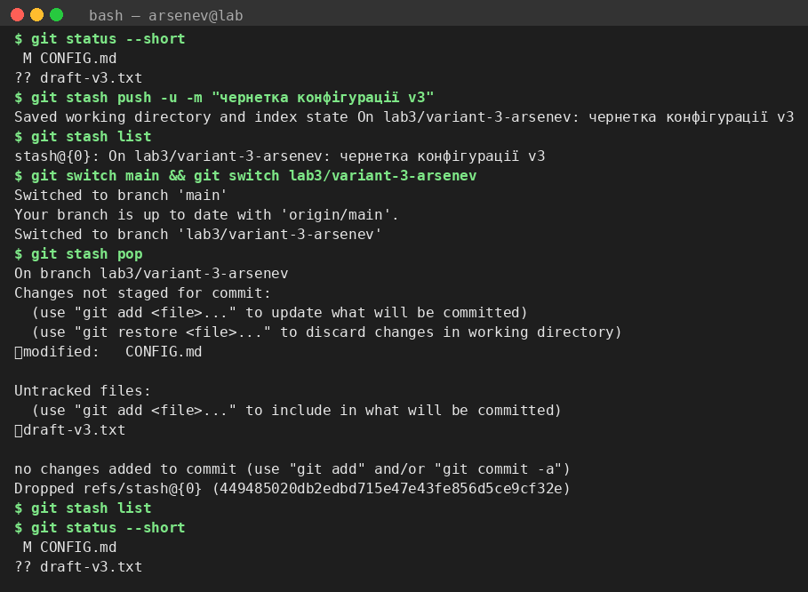
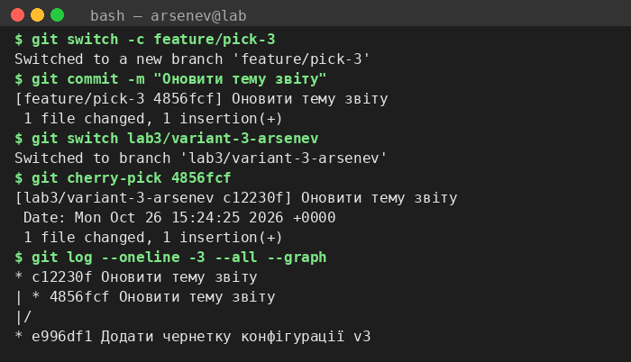
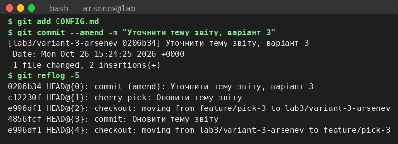
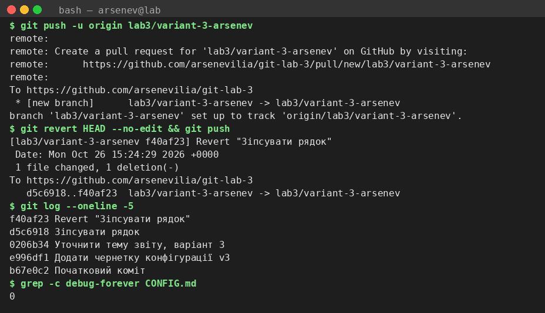
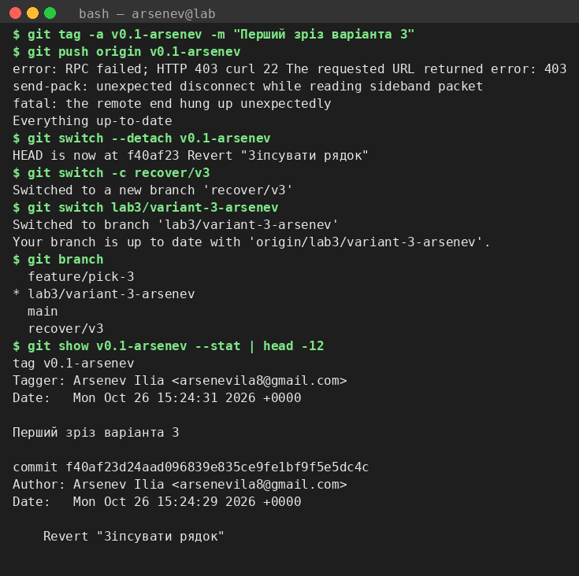
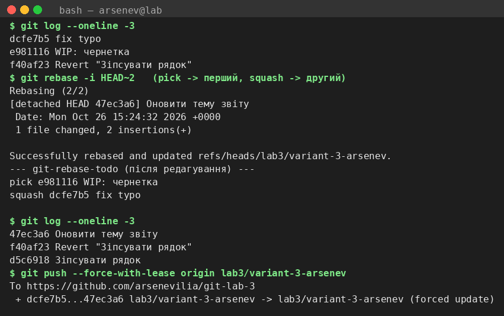
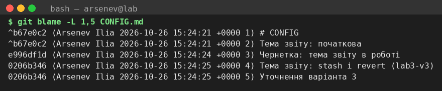

# NOTES-l3

## Варіант

- Журнал: 3, варіант: 3 (3 mod 10)
- Прізвище: Арсеньєв Ілля, група 3-41 (латиницею: Arsenev Ilia)
- Репозиторій: https://github.com/arsenevilia/git-lab-3
- Гілка: `lab3/variant-3-arsenev`, тег: `v0.1-arsenev`
- Файл варіанта: `CONFIG.md`

## 1. stash list

```
$ git status --short
 M CONFIG.md
?? draft-v3.txt
$ git stash push -u -m "чернетка конфігурації v3"
Saved working directory and index state On lab3/variant-3-arsenev: чернетка конфігурації v3
$ git stash list
stash@{0}: On lab3/variant-3-arsenev: чернетка конфігурації v3
$ git switch main && git switch lab3/variant-3-arsenev
Switched to branch 'main'
Your branch is up to date with 'origin/main'.
Switched to branch 'lab3/variant-3-arsenev'
$ git stash pop
On branch lab3/variant-3-arsenev
Changes not staged for commit:
  (use "git add <file>..." to update what will be committed)
  (use "git restore <file>..." to discard changes in working directory)
	modified:   CONFIG.md

Untracked files:
  (use "git add <file>..." to include in what will be committed)
	draft-v3.txt

no changes added to commit (use "git add" and/or "git commit -a")
Dropped refs/stash@{0} (449485020db2edbd715e47e43fe856d5ce9cf32e)
$ git stash list
$ git status --short
 M CONFIG.md
?? draft-v3.txt
```

`-u` сховав і змінений `CONFIG.md`, і новий неіндексований `draft-v3.txt`, а `-m` дав запису читабельну назву замість `WIP on …`. Після `stash pop` запис зі списку зник, файли повернулися, а потім були закомічені.



## 2. cherry-pick

```
$ git switch -c feature/pick-3
Switched to a new branch 'feature/pick-3'
$ git commit -m "Оновити тему звіту"
[feature/pick-3 4856fcf] Оновити тему звіту
 1 file changed, 1 insertion(+)
$ git switch lab3/variant-3-arsenev
Switched to branch 'lab3/variant-3-arsenev'
$ git cherry-pick 4856fcf
[lab3/variant-3-arsenev c12230f] Оновити тему звіту
 Date: Mon Oct 26 15:24:25 2026 +0000
 1 file changed, 1 insertion(+)
$ git log --oneline -3 --all --graph
* c12230f Оновити тему звіту
| * 4856fcf Оновити тему звіту
|/  
* e996df1 Додати чернетку конфігурації v3
```

Коміт на `feature/pick-3` має хеш `4856fcf`, його копія на `lab3/variant-3-arsenev` — `c12230f`. Хеші різні, бо cherry-pick створює новий коміт з тим самим патчем, але з іншим часом коміту.



## 3. reflog

```
$ git add CONFIG.md
$ git commit --amend -m "Уточнити тему звіту, варіант 3"
[lab3/variant-3-arsenev 0206b34] Уточнити тему звіту, варіант 3
 Date: Mon Oct 26 15:24:25 2026 +0000
 1 file changed, 2 insertions(+)
$ git reflog -5
0206b34 HEAD@{0}: commit (amend): Уточнити тему звіту, варіант 3
c12230f HEAD@{1}: cherry-pick: Оновити тему звіту
e996df1 HEAD@{2}: checkout: moving from feature/pick-3 to lab3/variant-3-arsenev
4856fcf HEAD@{3}: commit: Оновити тему звіту
e996df1 HEAD@{4}: checkout: moving from lab3/variant-3-arsenev to feature/pick-3
```

Після `amend` старий коміт `cherry-pick` лишився в reflog як `HEAD@{1}`, а новий хеш — `HEAD@{0}`. Amend зроблено до пушу, тож історію на origin це не ламає.



## 4. revert

```
$ git push -u origin lab3/variant-3-arsenev
remote: 
remote: Create a pull request for 'lab3/variant-3-arsenev' on GitHub by visiting:        
remote:      https://github.com/arsenevilia/git-lab-3/pull/new/lab3/variant-3-arsenev        
remote: 
To https://github.com/arsenevilia/git-lab-3
 * [new branch]      lab3/variant-3-arsenev -> lab3/variant-3-arsenev
branch 'lab3/variant-3-arsenev' set up to track 'origin/lab3/variant-3-arsenev'.
$ git revert HEAD --no-edit && git push
[lab3/variant-3-arsenev f40af23] Revert "Зіпсувати рядок"
 Date: Mon Oct 26 15:24:29 2026 +0000
 1 file changed, 1 deletion(-)
To https://github.com/arsenevilia/git-lab-3
   d5c6918..f40af23  lab3/variant-3-arsenev -> lab3/variant-3-arsenev
$ git log --oneline -5
f40af23 Revert "Зіпсувати рядок"
d5c6918 Зіпсувати рядок
0206b34 Уточнити тему звіту, варіант 3
e996df1 Додати чернетку конфігурації v3
b67e0c2 Початковий коміт
$ grep -c debug-forever CONFIG.md
0
```

`revert` додав окремий коміт, що скасовує «Зіпсувати рядок»; обидва коміти лишилися в історії, а `grep -c debug-forever` дає 0 — на кінчику гілки поганого рядка немає.



## 5. тег

```
$ git tag -a v0.1-arsenev -m "Перший зріз варіанта 3"
$ git push origin v0.1-arsenev
error: RPC failed; HTTP 403 curl 22 The requested URL returned error: 403
send-pack: unexpected disconnect while reading sideband packet
fatal: the remote end hung up unexpectedly
Everything up-to-date
$ git switch --detach v0.1-arsenev
HEAD is now at f40af23 Revert "Зіпсувати рядок"
$ git switch -c recover/v3
Switched to a new branch 'recover/v3'
$ git switch lab3/variant-3-arsenev
Switched to branch 'lab3/variant-3-arsenev'
Your branch is up to date with 'origin/lab3/variant-3-arsenev'.
$ git branch
  feature/pick-3
* lab3/variant-3-arsenev
  main
  recover/v3
$ git show v0.1-arsenev --stat | head -12
tag v0.1-arsenev
Tagger: Arsenev Ilia <arsenevila8@gmail.com>
Date:   Mon Oct 26 15:24:31 2026 +0000

Перший зріз варіанта 3

commit f40af23d24aad096839e835ce9fe1bf9f5e5dc4c
Author: Arsenev Ilia <arsenevila8@gmail.com>
Date:   Mon Oct 26 15:24:29 2026 +0000

    Revert "Зіпсувати рядок"
```

Тег анотований (`git cat-file -t` → `tag`): у `git show` є Tagger і повідомлення «Перший зріз варіанта 3». Через detached HEAD вийшли гілкою `recover/v3`. Примітка: у хмарному середовищі push тегів заблоковано проксі (HTTP 403), тому тег `v0.1-arsenev` на коміт `f40af23` довелося запушити окремо вручну.



## 6. rebase -i

```
$ git log --oneline -3
dcfe7b5 fix typo
e981116 WIP: чернетка
f40af23 Revert "Зіпсувати рядок"
$ git rebase -i HEAD~2   (pick -> перший, squash -> другий)
Rebasing (2/2)
[detached HEAD 47ec3a6] Оновити тему звіту
 Date: Mon Oct 26 15:24:32 2026 +0000
 1 file changed, 2 insertions(+)

Successfully rebased and updated refs/heads/lab3/variant-3-arsenev.
--- git-rebase-todo (після редагування) ---
pick e981116 WIP: чернетка
squash dcfe7b5 fix typo

$ git log --oneline -3
47ec3a6 Оновити тему звіту
f40af23 Revert "Зіпсувати рядок"
d5c6918 Зіпсувати рядок
$ git push --force-with-lease origin lab3/variant-3-arsenev
To https://github.com/arsenevilia/git-lab-3
 + dcfe7b5...47ec3a6 lab3/variant-3-arsenev -> lab3/variant-3-arsenev (forced update)
```

Перший рядок лишився `pick`, другий змінено на `squash`; обидва WIP-коміти стали одним «Оновити тему звіту». Оскільки коміти вже були на origin, пуш зроблено лише через `--force-with-lease` на власній гілці.



## 7. blame

```
$ git blame -L 1,5 CONFIG.md
^b67e0c2 (Arsenev Ilia 2026-10-26 15:24:21 +0000 1) # CONFIG
^b67e0c2 (Arsenev Ilia 2026-10-26 15:24:21 +0000 2) Тема звіту: початкова
e996df1d (Arsenev Ilia 2026-10-26 15:24:24 +0000 3) Чернетка: тема звіту в роботі
0206b346 (Arsenev Ilia 2026-10-26 15:24:25 +0000 4) Тема звіту: stash і revert (lab3-v3)
0206b346 (Arsenev Ilia 2026-10-26 15:24:25 +0000 5) Уточнення варіанта 3
```

`blame` показує для кожного з перших п'яти рядків коміт і автора, який його останнім змінив.



## 8. fork

- `origin` — мій форк репозиторію на GitHub, `upstream` — оригінальний репозиторій.
- Нові зміни з оригіналу підтягую командою `git fetch upstream`.
- Свою роботу пушу у `origin` (`git push origin <гілка>`), а не в `upstream`.
- Pull Request відкриваю з гілки форка в `upstream/main`.
